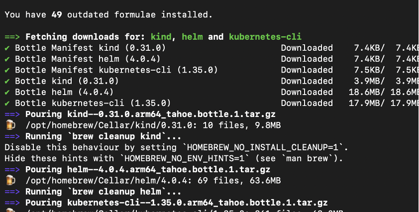
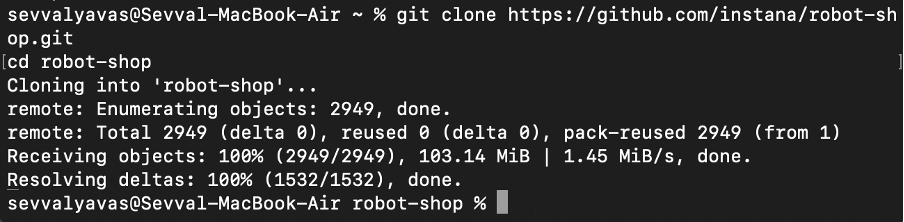
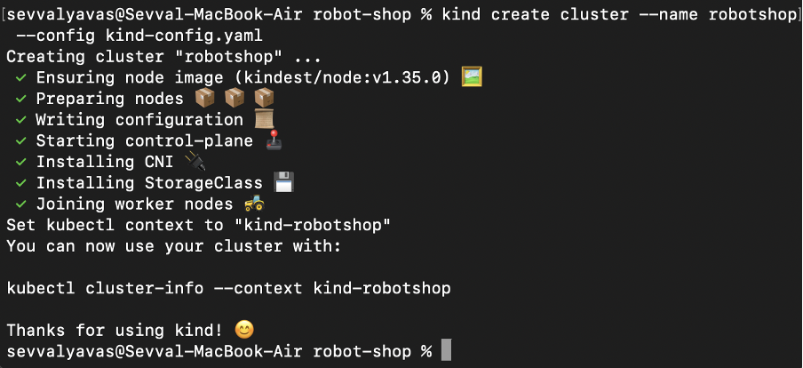
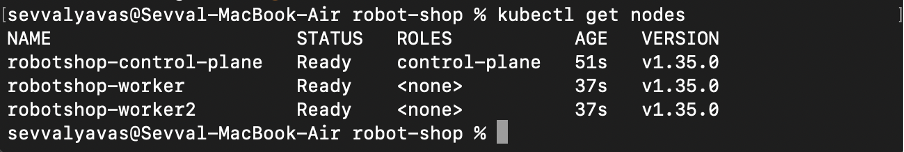
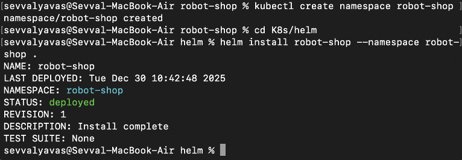
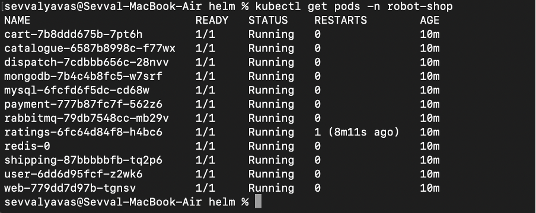
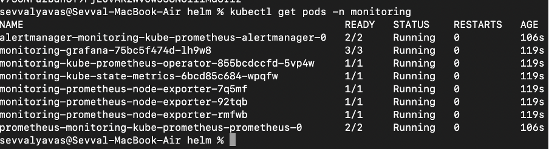

# Kind Cluster Oluşturma ve RobotShop Deploy Rehberi

Bu doküman, **Kind (Kubernetes in Docker)** kullanarak lokal bir Kubernetes cluster oluşturmayı, **RobotShop** uygulamasını deploy etmeyi ve **Prometheus & Grafana** ile izleme kurulumunu adım adım anlatır.

---

## Ön Koşullar
- Docker
- Git

Kind dokümantasyonu: https://kind.sigs.k8s.io/

---

## 1. Gerekli Araçların Kurulumu

### MacOS
```bash
brew install kind helm kubectl
```



### Windows
```powershell
winget install Kubernetes.kind
winget install Helm.Helm
winget install Kubernetes.kubectl
```


## 2. RobotShop Repository’sini Klonlama
```bash
git clone https://github.com/instana/robot-shop.git
cd robot-shop
```



## 3. Kind Cluster Yapılandırma Dosyası

### MacOS / Linux
```bash
cat <<EOF > kind-config.yaml
kind: Cluster
apiVersion: kind.x-k8s.io/v1alpha4
nodes:
- role: control-plane
- role: worker
- role: worker
EOF
```

### Windows
```yaml
kind: Cluster
apiVersion: kind.x-k8s.io/v1alpha4
nodes:
- role: control-plane
- role: worker
- role: worker
```

```yaml
web'de de açabilmek için köprü oluşturma (güncel)(sevim)
kind: Cluster
apiVersion: kind.x-k8s.io/v1alpha4
nodes:
- role: control-plane
  extraPortMappings:
  - containerPort: 31080
    hostPort: 8080
    protocol: TCP
- role: worker
- role: worker
```

## 4. Kind Cluster Oluşturma
```bash
kind create cluster --name robot-shop --config kind-config.yaml
```


## 5. Node Kontrolü
```bash
kubectl get nodes
```


## 6. RobotShop Deploy (Helm)
```bash
kubectl create namespace robot-shop
cd K8s/helm
helm install robot-shop --namespace robot-shop .
```


## 7. Pod Kontrolü
```bash
kubectl get pods -n robot-shop
```


## 8. Uygulamaya Erişim
```bash
kubectl port-forward svc/web 8080:8080 -n robot-shop
```


## 9. Prometheus & Grafana Kurulumu
```bash
helm repo add prometheus-community https://prometheus-community.github.io/helm-charts
helm repo update
kubectl create namespace monitoring
helm install monitoring prometheus-community/kube-prometheus-stack --namespace monitoring
```

## 10. Grafana Şifre Alma

### MacOS
```bash
kubectl get secret --namespace monitoring monitoring-grafana -o jsonpath="{.data.admin-password}" | base64 --decode ; echo
```

### Windows
```powershell
$pass = kubectl get secret --namespace monitoring monitoring-grafana -o jsonpath="{.data.admin-password}"
[System.Text.Encoding]::UTF8.GetString([System.Convert]::FromBase64String($pass))
```


## 11. Grafana Erişim
```bash
kubectl port-forward svc/monitoring-grafana 3000:80 -n monitoring
```

## 12. JMeter Kurulumu

### MacOS
```bash
brew install jmeter
jmeter
```

### Windows
```powershell
winget install Apache.JMeter
```
